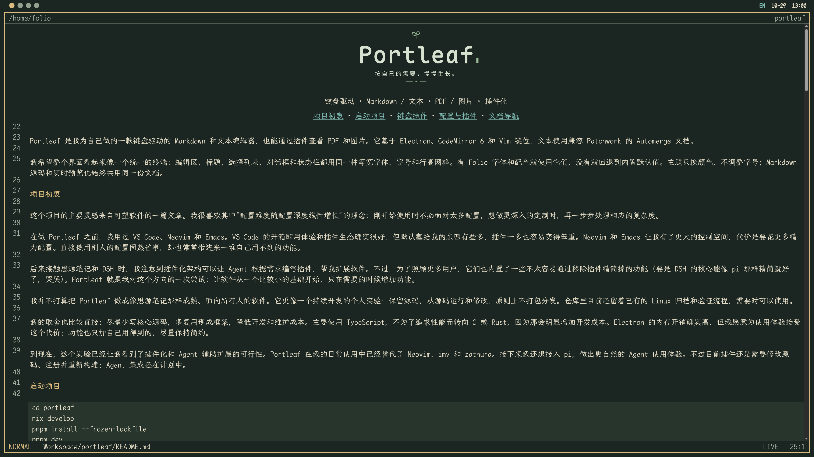

<div align="center">

<h1>
  <picture>
    <source media="(prefers-color-scheme: dark)" srcset="assets/branding/header-dark.svg">
    <source media="(prefers-color-scheme: light)" srcset="assets/branding/header-light.svg">
    
  </picture>
</h1>

<p><sub>键盘驱动 · Markdown / 文本 · PDF / 图片 · 插件化</sub></p>

<p>
  <a href="#项目初衷">项目初衷</a> ·
  <a href="#启动项目">启动项目</a> ·
  <a href="#键盘操作">键盘操作</a> ·
  <a href="#配置与插件">配置与插件</a> ·
  <a href="#文档导航">文档导航</a>
</p>

</div>

Portleaf 是我为自己做的一款键盘驱动的 Markdown 和文本编辑器，也能通过插件查看 PDF 和图片。它基于 Electron、CodeMirror 6 和 Vim 键位，文本使用兼容 Patchwork 的 Automerge 文档。



我希望整个界面看起来像一个统一的终端：编辑区、标题、选择列表、对话框和状态栏都用同一种等宽字体、字号和行高网格。有 Folio 字体和配色就使用它们，没有就回退到内置默认值。主题只换颜色，不调整字号；Markdown 源码和实时预览也始终共用同一份文档。

## 项目初衷

这个项目的主要灵感来自可塑软件的一篇文章。我很喜欢其中“配置难度随配置深度线性增长”的理念：刚开始使用时不必面对太多配置，想做更深入的定制时，再一步步处理相应的复杂度。

在做 Portleaf 之前，我用过 VS Code、Neovim 和 Emacs。VS Code 的开箱即用体验和插件生态确实很好，但默认塞给我的东西有些多，插件一多也容易变得笨重。Neovim 和 Emacs 让我有了更大的控制空间，代价是要花更多精力配置。直接使用别人的配置固然省事，却也常常带进来一堆自己用不到的功能。

后来接触思源笔记和 DSH 时，我注意到插件化架构可以让 Agent 根据需求编写插件，帮我扩展软件。不过，为了照顾更多用户，它们也内置了一些不太容易通过移除插件精简掉的功能（要是 DSH 的核心能像 pi 那样精简就好了，哭哭）。Portleaf 就是我对这个方向的一次尝试：让软件从一个比较小的基础开始，只在需要的时候增加功能。

我并不打算把 Portleaf 做成像思源笔记那样成熟、面向所有人的软件。它更像一个持续开发的个人实验：保留源码，从源码运行和修改，原则上不打包分发。仓库里目前还留着已有的 Linux 归档和验证流程，需要时可以使用。

我的取舍也比较直接：尽量少写核心源码，多复用现成框架，降低开发和维护成本。主要使用 TypeScript，不为了追求性能而转向 C 或 Rust，因为那会明显增加开发成本。Electron 的内存开销确实高，但我愿意为使用体验接受这个代价；功能也只加自己用得到的，尽量保持简约。

到现在，这个实验已经让我看到了插件化和 Agent 辅助扩展的可行性。Portleaf 在我的日常使用中已经替代了 Neovim、imv 和 zathura。接下来我还想接入 pi，做出更自然的 Agent 使用体验。不过目前插件还是需要修改源码、注册并重新构建；Agent 集成还在计划中。

## 启动项目

```sh
cd portleaf
nix develop
pnpm install --frozen-lockfile
pnpm dev
```

平时开发用 `pnpm dev` 就好：源码或依赖变了就重新构建，没有变化就复用现有产物。如果想完整地检查并重新构建，可以运行 `pnpm build`。

构建完成后，可以直接打开目录或文件：

```sh
pnpm start /path/to/notes
pnpm start /path/to/note.md
pnpm start /path/to/book.pdf
pnpm start /path/to/image.png
```

我把开发工具放在由锁文件固定版本的 Nix 环境里，包括 Node、pnpm、Electron、nixfmt 和 xvfb-run。启动器使用这个环境中的 Electron；`nix develop` 会设置 `ELECTRON_SKIP_BINARY_DOWNLOAD=1` 和 `PORTLEAF_ELECTRON`。

## 键盘操作

文本缓冲区打开后默认处于 Vim 普通模式。移动、操作符、计数、可视选择、搜索、寄存器、撤销和重做都来自 `@replit/codemirror-vim`。应用命令以空格键 `Space` 开头，在普通模式下执行；如果正在输入文字，可以先按 `Esc` 回到普通模式。插入模式下的空格仍然是普通输入。

文本编辑的这套操作需要启用 `vim` 插件。PDF 和图片查看器有自己的局部按键和空格命令适配器，不依赖 Vim。打开面板后，照着面板里的按键提示操作就可以。

| 操作                         | 按键                      |
| ---------------------------- | ------------------------- |
| 打开命令列表                 | `Space Space`             |
| 查看快捷键                   | `Space ?`                 |
| 打开文件选择器               | `Space f f`               |
| 按路径打开文本文件           | `Space f t`               |
| 打开 PDF 或图片              | `Space f v`               |
| 重新加载 PDF 或图片          | `Space v r`               |
| 查看文档大纲                 | `Space m o`               |
| 新建文件                     | `Space f n`               |
| 重命名当前文件               | `Space f r`               |
| 复制当前文件                 | `Space f c`               |
| 查看当前文件历史             | `Space f h`               |
| 切换缓冲区                   | `Space b b`               |
| 下一个／上一个缓冲区         | `Space b n` / `Space b p` |
| 关闭当前缓冲区               | `Space b d`               |
| 切换 Markdown 源码／实时预览 | `Space m v`               |
| 跟随光标处链接               | `Space m l`               |
| 切换光标处任务状态           | `Space m t`               |
| 选择主题                     | `Space u t`               |
| 选择文件语言                 | `Space u l`               |
| 退出应用                     | `Space q q`               |

命令序列、命令列表、快捷键参考和前缀提示都来自同一组插件声明。按空格后会出现两列快捷键，每页六行；`Tab` / `Shift+Tab` 或 `PageDown` / `PageUp` 可以翻页，不会打断正在输入的命令，`Esc` 则取消当前序列。原生 `:w`、`:q`、`:wq` 仍然可用，文件也会自动保存。我没有另外添加应用级 Ctrl 快捷键、自定义 Ex 别名或切换工作区命令；Vim 原生 Ctrl 键位不受影响。

命令、缓冲区、主题、历史和快捷键列表都使用相同的两列布局：方向键或 `hjkl` 移动，`Enter` 选择，`Esc` 关闭，翻页键与前缀提示相同。列表显示简短标签，搜索时仍会匹配完整名称；空格不会开始搜索或确认选择。

想搜索列表时按 `/`。搜索状态下，`Enter` 选择高亮结果；第一次按 `Esc` 会清空搜索并恢复之前的选择，再按一次才关闭列表。搜索框和名称输入框都可以正常输入空格。名称输入用 `Enter` 确认、`Esc` 取消；面板关闭后，焦点会回到打开它的编辑器或文件选择器。

## 文件选择器

按 `Space f f` 可以打开带预览的文件选择器，初始位置在当前文件所在目录。目录、支持的文件和可恢复的已分离文本文档都会出现在列表中。

默认启用的 `text-files` 插件让选择器除了 Markdown，还能浏览 UTF-8 文本。列表先做有限的内容检查，过滤二进制和无效 UTF-8 候选文件，打开时再校验完整内容。`media-viewer` 则加入 PDF 和图片，预览只显示元数据。某种格式的查看器被禁用后，即使文件字节恰好能解码为 UTF-8，也不会把它当作文本列出来。

我把点号开头的文件、目录，以及隐藏目录里的路径排除在列表、目录预览和递归搜索之外。浏览与文件操作限制在启动时打开的目录内；如果直接打开文件，范围就是它的父目录。不需要另外设置工作区，外部目录变化也会自动刷新列表。

目录导航参考了 [Yazi 的操作方式](https://yazi-rs.github.io/docs/quick-start/)，我也把常用文件操作放在了选择器里：

| 操作                       | 按键                    |
| -------------------------- | ----------------------- |
| 向下／向上移动             | `j` / `k`，或方向键     |
| 返回父目录                 | `h` / `Left`            |
| 进入目录／打开文件         | `l` / `Right` / `Enter` |
| 跳到首项／末项             | `gg` / `G`              |
| 在当前目录新建文件         | `n`                     |
| 重命名选中文件             | `r`                     |
| 将选中文件复制为新文件     | `c`                     |
| 查看选中文件历史           | `H`（`Shift+h`）        |
| 在当前目录新建目录         | `m`                     |
| 递归搜索当前目录下的文件名 | `/`                     |
| 关闭选择器                 | `q` / `Esc`             |

这些按键只在文件选择器中生效。底部提示按三行三列排列，名称和搜索内容都可以正常输入空格与字母。

启用 `text-files` 时，新建文件会保留 `.txt`、`.json`、`.nix` 等显式扩展名；没有扩展名的名称默认补上 `.md`。如果想创建 `Makefile` 这样的无扩展名文件，可以使用命令列表中的“精确命名新建文本文件”（`New text file (exact name)`）。不启用这个插件时，新文件使用 Markdown 扩展名。

复制和重命名时需要输入目标名称，已有目标不会被覆盖。重命名已打开的文档会保留文档身份、视图、光标和撤销历史；复制则创建独立文档，同时保留编码。目前还没有目录重命名、多选和剪切粘贴。

搜索文件时，先按 `Enter` 返回结果列表，再用 `l` 或 `Enter` 打开选中项；`Esc` 清空搜索。按 `H` 可以查看选中文本文件的历史，不必先打开它。历史列表会先预览版本，再按 `Enter` 恢复；取消后回到原来的目录和选中项。新建、复制、重命名和历史恢复目前只适用于文本文档。

## 文本文件与大纲

我用 `text-files` 插件打开、编辑和预览 UTF-8 文本，包括代码、配置和无扩展名文件。`Space f t` 接受相对于打开目录的路径，也可以显式打开隐藏路径。这些文本缓冲区同样支持 Vim 编辑、撤销、自动保存、外部更新、历史、复制、重命名和恢复，但内容按原文显示，不做 Markdown 实时渲染，也没有 `LIVE/SOURCE` 按钮。

语法高亮使用 CodeMirror 的语言目录，按需加载 JavaScript/TypeScript、Python、Rust、Go、C/C++、Java、JSON、YAML、TOML、HTML/CSS、Shell、Nix 等语言。应用会根据文件名、扩展名、常见配置名和脚本首行解释器声明自动识别语言。也可以按 `Space u l` 或点击状态栏语言按钮，手动选择语言、自动识别（`Auto-detect`）或纯文本（`Plain text`）。手动选择只属于当前缓冲区，换主题后还在；自动识别会随重命名和解释器声明变化更新。识别不出来就显示为纯文本。目前没有语言服务器。

禁用 `text-files` 后，通用文本浏览功能会消失；Markdown、已启用查看器支持的格式和已经打开的可编辑文本缓冲区仍会保留。

我还加了 `outline` 插件：按 `Space m o` 就能在源码或实时预览中打开当前 Markdown 的可搜索标题列表。它显示标题层级和源码行号，默认选中当前章节，按 `Enter` 跳转；代码块和前置元数据不会被当作标题。文档变化或切换缓冲区时，大纲会关闭，避免跳到过期位置。`outline` 和 `text-files` 可以独立启用；已有显式插件列表需要自行加入 `"outline"` 和 `"text-files"`。

## PDF 与图片

我希望看文档和图片时也不用离开编辑器，所以做了只读的 `media-viewer` 插件。可以从文件选择器、`Space f v` 或启动参数打开 PDF 和图片。支持 PNG、JPEG、GIF、WebP、AVIF、BMP、SVG、ICO，实际能否解码还取决于 Chromium。查看器共用缓冲区列表和全局空格命令，二进制内容不会进入文本或 CRDT 流程。

PDF 按键参考 zathura：`J/K` 或 `PageDown/PageUp` 翻页，`hjkl` 和方向键平移，`gg` / `G` / 数字后接 `G` 跳转，`+/-` 缩放，`a` 适配窗口，`s` 适配宽度，`=` 使用原始大小，`r` 旋转。`/` 搜索文本，`n/N` 切换结果，`Tab` 打开目录。当前页有可选择的文本层；PDF.js 和工作线程只在打开 PDF 时加载。

图片按键参考 imv：左右方向键或方括号在同目录图片间循环，`hjkl` 平移，`i/o` 或 `+/-` 缩放，`s` 切换适配方式，`a` 使用原始大小，`Ctrl+r` 旋转，`r` 重置，`Tab` 打开图片列表。同目录切换会替换当前图片缓冲区，避免浏览时一直积累解码图片；按路径显式打开的文件可以分别保留。

两种查看器都可以用 `:` 输入序号、`R` 重新加载、Ctrl 加滚轮缩放、`q` 关闭当前缓冲区。图片可以用鼠标左键拖动；PDF 用中键拖动，`Ctrl+r` 切换阅读配色。空格仍然留给应用命令。

新配置默认启用 `media-viewer`，已有显式插件列表需要加入 `"media-viewer"`。选项放在 `pluginSettings.media-viewer`：`zoomStep` 默认 1.2，`maxCanvasPixels` 默认 16000000，`imageBackground` 可选 `"checkerboard"` 或 `"theme"`。文件变化后查看器会刷新；关闭视图或禁用插件时会取消请求并释放资源。

目前还没有媒体文件复制、重命名和文本历史，也不支持密码输入、OCR、连续／双页布局和 PDF 编辑。完整按键与配置见[内置插件参考](docs/plugins.md#媒体查看器)，接口与生命周期见[架构说明](docs/architecture.md)。

## Markdown 视图

新缓冲区默认进入实时预览，状态栏显示 `LIVE`。在普通模式按 `Space m v` 可以切换到源码模式 `SOURCE`；命令列表里的“切换 Markdown 视图”（`Toggle Markdown view`）和状态栏的 `LIVE/SOURCE` 按钮也能做同一件事。

实时预览支持强调、删除线、行内代码、引用、列表、任务框、链接、图片、表格、代码块和行内／块级 LaTeX 公式。标题仍然使用正文字号；原始 HTML 和前置元数据按原文显示。本地图片相对于文档解析，真实路径和符号链接目标都必须在工作区内；HTTP(S) 图片也受支持。

把光标移进格式化内容，就能看到 Markdown 标记。公式、表格、图片和代码块在光标进入时显示源码，点击渲染块也可以编辑；离开后恢复预览。任务框和 `Space m t` 修改真实的 `[ ]` / `[x]` 标记，因此可以撤销，也会自动保存。`Space m l` 可以打开相对路径 Markdown、标题锚点或网页链接。

这两种视图用的是同一个 CodeMirror 文档和 Patchwork 绑定。切换时保留选择、Vim 模式和撤销历史，不会重写文件或额外保存。每个缓冲区记住自己的视图，切换缓冲区或主题也不会丢失。输入法正在组词时，先完成输入再切换视图。

## 文件同步与历史

Patchwork 数据服务运行在后台 Node 工作线程中。编辑会自动保存到本地 CRDT 存储，稍后写回普通文本文件；其他编辑器的修改也会实时更新已打开的缓冲区。外部并发修改从最后确认的磁盘版本导入，再与本地操作合并；远端修改不会进入本地撤销栈。输入法组词期间，同步消息会等到本次输入提交。

打开 UTF-8 文本不会改变原有字节，导出时保留 LF/CRLF 和 UTF-8 BOM。混合换行文件以只读方式打开；文本流程拒绝二进制、无效 UTF-8 和单独的回车字符。PDF 和图片走独立的只读资源流程，不进入文本历史或自动导出。

CRDT 历史和投影元数据保存在 `$XDG_STATE_HOME/portleaf/workspaces/`，默认位置是 `~/.local/state/portleaf/workspaces/`。文件被删除后，文档会作为已分离文档保留，不会自动重新创建；需要时可以用“复制为新文件”（`Copy to new file`）恢复。历史选择器最多显示 100 个版本，底层 CRDT 保留完整历史。

这里也有我不想掩盖的限制：CRDT 可以确定性地合并并发操作，但不能保证同一句话的并发修改符合你的本意。普通文件也无法与任意外部写入方进行原子的比较后替换。投影日志和内容复查缩小了冲突窗口，但最终检查与重命名之间，仍可能有未被观察到的写入。

## 可靠性与恢复

重命名使用持久化意图日志和原生非覆盖移动。打开工作区前会恢复未完成的移动；出现替换冲突时，保留两侧路径和日志供恢复。内核锁阻止多个进程同时写入同一工作区存储，所以应用可能仍在运行时，不要删除 `workspace.lock`。

关闭文本缓冲区前，应用会确认编辑已同步并完成本地持久化，然后释放两端文档副本。干净的非活动文档和已浏览目录使用有界缓存。文件投影失败时，本地历史仍会保留并显示错误；保存一个文件不需要无关的已关闭文件也能导出。

退出时如果有文档无法导出，可以选择重试（`Retry`）、取消（`Cancel`），或保存恢复副本并退出（`Save recovery copy and quit`）。工作线程故障时编辑区会变为只读，并提供恢复／重启动作。恢复 JSON 会私密地写入状态根目录下的 `recovery/`，保留能取得的不同文本版本。需要提取时运行：

```sh
pnpm recover /path/to/recovery.json /path/to/new-recovery-directory
```

提取会创建独立的 UTF-8/LF 文件和清单，不覆盖原文件。渲染进程崩溃后，可以恢复工作线程已有的历史；但还没有到达那里的编辑可能无法恢复。

仓库里也保留了 `pnpm package`，可以生成 Linux 应用归档。运行它需要系统 Electron、GNU coreutils 的 `mv` 和 util-linux 的 `flock`；具体安装与运行要求见[发布指南](docs/distribution.md)。

## 配置与插件

配置在使用前会经过校验。启动时如果用户 JSON 或字段类型无效，应用会使用默认值并提示修复，不会重写原文件；运行中的无效更新则保留当前配置。修复并保存文件后会重新加载，切换主题时也不会覆盖无效配置。

配置文件默认位于 `~/.config/portleaf/config.json`；设置 `XDG_CONFIG_HOME` 后，文件位于 `$XDG_CONFIG_HOME/portleaf/config.json`：

```json
{
  "pluginApiVersion": 1,
  "plugins": [
    "markdown",
    "markdown-visual",
    "markdown-html",
    "vim",
    "file-browser",
    "navigation",
    "history",
    "outline",
    "text-files",
    "media-viewer"
  ],
  "markdownMode": "live",
  "theme": "folio",
  "fontFamily": "LXGW WenKai Mono GB",
  "fontSize": 18,
  "pluginSettings": {
    "media-viewer": {
      "zoomStep": 1.2,
      "maxCanvasPixels": 16000000,
      "imageBackground": "checkerboard"
    }
  }
}
```

`fontSize` 是整个应用共用的字号，单位为磅。主题可选 `folio` 和 `minimal`，配置与 Folio 外观变化会实时监听。将 `markdownMode` 设为 `"source"`，新缓冲区就会默认打开源码模式，已有缓冲区保留自己的视图。如果配置里已经显式列出插件，需要加入 `"markdown-visual"` 才能启用实时预览，并加入 `"markdown-html"` 渲染 HTML。

版本 1 把 `file-browser` 和 `navigation` 分成了独立插件。旧配置如果列出了插件，但没有声明 `pluginApiVersion`，会自动保留文件浏览功能；想分别控制这两个插件时，设置 `"pluginApiVersion": 1` 即可。

插件目前都是显式注册的内置 ESM 模块。文本功能使用 CodeMirror 扩展、Facet、视图插件和 Compartment；非文本查看器提供文件格式和 `FileView` 工厂。插件专属配置位于 `pluginSettings[pluginId]`，由各自插件解释。Markdown 在工作线程中解析，KaTeX 只在显示公式时加载，PDF.js 只在打开 PDF 时加载。禁用的实现不会执行，但构建仍包含全部内置代码和资源。目前没有第三方插件安装、完整 Neovim/Lua 兼容或跨设备同步。

我把每个插件放在 `packages/plugins/src/` 下的独立目录里：`manifest.ts` 声明轻量元数据，`index.ts` 提供实现，说明集中在[插件参考](docs/plugins.md)。唯一的注册表是 `packages/plugins/src/index.ts`，只加载已启用插件和依赖。宿主负责校验标识符、依赖、命令归属与空格绑定冲突，并合并文件浏览能力；插件负责自己的面板和监听，禁用时释放。文本行为使用原生 Compartment，主题负责配色与高亮，宿主负责字体和行高。添加内置插件需要注册并重新构建，细节见[插件开发约定](docs/plugin-contract.md)。

## 开发与验证

```sh
pnpm check
pnpm test
pnpm test:unit
pnpm test:integration
pnpm test:e2e
pnpm format:check
pnpm bench current
```

Electron 端到端测试会使用独立 Xvfb 显示，以及临时文件和配置，不会碰真实笔记。包内测试放在 `apps/desktop/test/` 与 `packages/*/test/`，Electron 场景放在 `tests/e2e/`。报告、截图、性能采样、构建产物和发布归档都不进入版本控制；需要清理时运行 `pnpm clean`。依赖锁文件则留着，方便复现安装。

## 文档导航

| 指南                                    | 内容                                 |
| --------------------------------------- | ------------------------------------ |
| [开发指南](docs/development.md)         | 环境、命令、目录结构和仓库维护       |
| [架构说明](docs/architecture.md)        | 进程边界、数据流、持久化和恢复保证   |
| [内置插件参考](docs/plugins.md)         | 插件功能、命令、配置及完整查看器按键 |
| [插件开发约定](docs/plugin-contract.md) | 公共接口、生命周期、注册和资源归属   |
| [测试指南](docs/testing.md)             | 测试分层、夹具、报告和验证流程       |
| [性能说明](docs/performance.md)         | 资源策略、性能采样和可复现基准       |
| [Linux 发布指南](docs/distribution.md)  | 打包、安装和运行依赖                 |

## 许可证

项目代码以 [MIT 许可证](LICENSE)发布。品牌图中的字形轮廓来自 [Maple Mono](https://github.com/subframe7536/maple-font)，使用 [SIL Open Font License 1.1](assets/branding/OFL.txt)；其他第三方依赖遵循各自的许可证。
