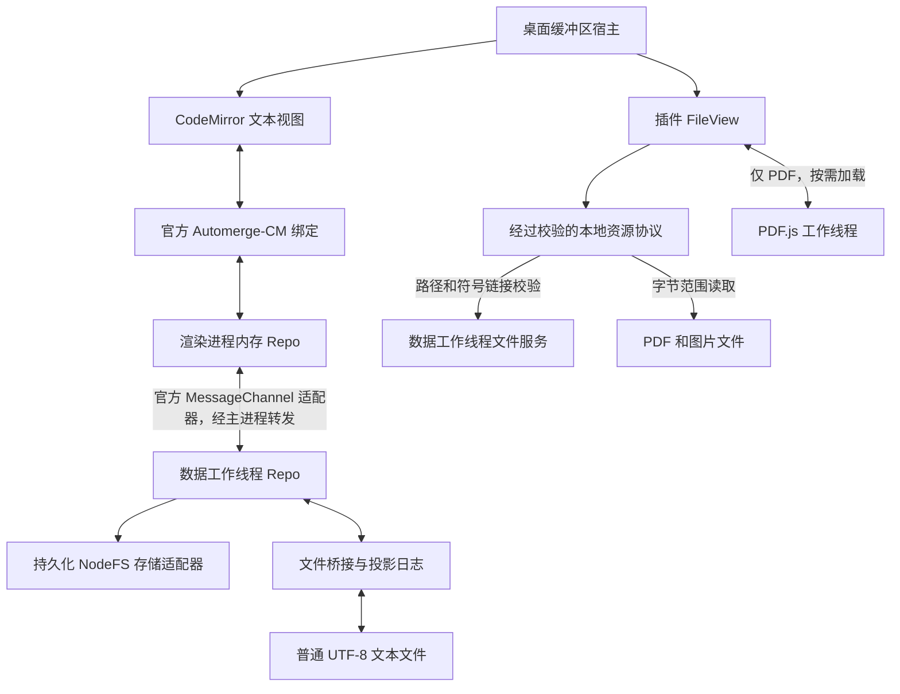

# Portleaf 架构说明

## 产品约束

Portleaf 直接编辑 Markdown 和 UTF-8 文本，提供 Vim 模式和键盘操作。应用只有一份文本模型，不通过 Markdown 序列化往返，也不维护独立的富文本缓冲区。PDF 和图片由插件提供只读视图，二进制内容不进入文本模型。

应用采用类似终端的排版：统一等宽字体、字号和行高网格。标题通过语法颜色区分，不放大字号；字体和行高不随窗口宽度变化。PDF 保留文档自身排版，通过查看器独立缩放。源码注释和现有界面文本沿用英文，开发文档使用中文。

## 复用的机制

| 项目                                                                        | 使用的机制                                  |
| --------------------------------------------------------------------------- | ------------------------------------------- |
| [CodeMirror 6](https://codemirror.net/docs/guide/)                          | 扩展组合、Facet、事务、状态字段和视图插件   |
| [CodeMirror 配置](https://codemirror.net/examples/config/)                  | 使用 Compartment 在重新配置时保留文档和历史 |
| [VS Code](https://code.visualstudio.com/api/references/contribution-points) | 小型声明式命令与主题贡献                    |
| [Neovim](https://neovim.io/doc/user/api/)                                   | 独立于视图的缓冲区，以及不同入口共享的命令  |
| [Patchwork](https://github.com/inkandswitch/patchwork-system)               | 文件文档结构、元数据和稳定的 Automerge 身份 |

插件系统在 CodeMirror 现有扩展机制之上增加一层轻量应用组合，不维护第二套编辑器状态机、通用服务容器、自定义 CRDT 或 Vim 实现。Electron 让桌面宿主与 Patchwork、CodeMirror 处于同一 TypeScript 生态；嵌入完整 Neovim 则需要额外的界面网格、RPC 和缓冲区适配层，只有需要完整 Lua／插件兼容时才有必要重新评估。运行时体积与源码体积应分别衡量。

## 源码结构

```text
apps/desktop/
  src/main.ts             窗口、经过校验的 IPC、同步端口转发
  src/resource-range.ts   本地资源的字节范围校验
  src/data-service.ts     Comlink 客户端与数据工作线程生命周期
  src/data-worker.ts      Node 工作线程中的 Workspace、Repo 和文件桥接
  src/preload.ts          范围受限的上下文桥接
  src/boot.ts             编辑器依赖加载前的轻量界面
  src/renderer.ts         缓冲区和视图组合、公共宿主服务
  src/collaboration.ts    官方绑定集成与输入法组词协调
  src/settings.ts         配置和可选 Folio 配色
  src/style.css           结构布局与统一字体、行高网格
packages/
  core/src/               公共约定、应用生命周期、命令、Compartment、作用域选择器
  data-patchwork/src/     Repo、持久存储、编码格式和文件桥接
  plugins/src/            每个插件一个目录；index.ts 是显式注册表
tests/e2e/                真实 Electron 键盘和输入法测试
{apps,packages}/*/test/   各包的单元及文件系统、进程集成测试
```

桌面层组合其他包；核心层不导入具体插件；数据包不导入 DOM 或界面代码。插件通过公共接口和上游 API 工作。

## 数据流



渲染进程禁用 Node 集成，启用上下文隔离和渲染沙箱。IPC 校验主框架。Node 工作线程负责持久化和文件监听；主线程授权文件 IPC，并通过 Comlink 转发类型化调用。`MessagePortMain` 消息被转发到数据工作线程中官方网络适配器使用的原生 Node `MessagePort`。跨 Electron 边界时缓冲区通过克隆传递，而非转移所有权。

离线依赖版本固定在 `pnpm-lock.yaml`：Patchwork filesystem 0.2.16、Automerge 3.5.0、Repo/NodeFS/MessageChannel 2.5.1、Automerge-CM 0.2.0 和 Vim 6.4.0。应用不需要 Patchwork 完整网页外壳或实验性的 Subduction 技术栈。

## 插件与主题

[插件开发约定](plugin-contract.md)定义 API 版本 1、开发规则和示例。插件描述符声明标识符、依赖、命令、可选外观和可选文件查看格式。应用级 `PluginHost` 校验注册表及当前配置，每个启用插件激活一次，并在文本缓冲区安装原生 Compartment。替换有效配置前，宿主会先准备新激活和编辑器状态事务；同步准备失败时清理暂存资源并保留旧配置。

各插件分目录维护：

- `markdown`：Markdown 语言和括号匹配。
- `markdown-visual`：源码／实时预览、公式、表格、图片、链接、任务和状态栏。
- `vim`：上游 Vim 引擎、原生 Ex 集成及空格命令适配器。
- `file-browser`：独立启用的文件选择器、文件操作、作用域提示、刷新订阅和定时器，并可调用历史命令。
- `navigation`：命令、帮助、缓冲区和主题选择器。
- `outline`：使用共享解析工作线程提供可搜索标题与源码行跳转。
- `text-files`：文本浏览、路径打开、精确命名创建、括号匹配与按需语法高亮。
- `media-viewer`：PDF／图片视图、局部按键、按需 PDF.js 渲染、搜索、大纲和同目录图片导航。
- `history`：通过数据服务预览与恢复版本。
- `theme-minimal` / `theme-folio`：外观名称、配色和原生高亮。

注册表导入轻量清单并声明动态加载器，核心层只在激活前准备已启用实现及依赖。桌面层只导入内置注册表，不维护 Markdown、文件选择器或历史功能专用的动作分发器。插件的空格键、命令列表条目和状态栏按钮都通过公共命令注册表执行。

每次激活有自己的选择器作用域；禁用插件会释放自身界面、监听器、定时器和处理函数。依赖先激活、后释放。受信任插件的运行时错误会被报告，当前没有独立扩展进程或权限沙箱。

核心层在应用范围内应用配色令牌，不依赖缓冲区生命周期。主题来自注册表，而非桌面层硬编码白名单；结构 CSS 和宿主字体设置提供共用字号与行高网格。关闭缓冲区不会移除应用外观。Folio 外观数据是可选配置。外部插件安装尚未实现，修改显式注册表后需要重新构建。

Vim 默认的单空格移动被移除，以便使用前缀命令。插件在命令声明中附加空格后的按键序列，Vim 适配器通过上游 `defineAction` / `mapCommand` 注册，不再实现另一套序列匹配器。命令列表、快捷键参考和前缀提示读取同一 Facet；映射只分发当前缓冲区中可用的命令，禁用插件无法通过过期全局映射继续执行。原生 `:w`、`:q`、`:wq` 保留；插入模式的空格保持普通输入。隐藏缓冲区时视图仍挂载，以保留各自的 Vim 与撤销状态。

快捷键提示使用两列、每页六行。`Tab` / `Shift+Tab` 和 `PageDown` / `PageUp` 在不改变 Vim 待处理按键的情况下翻页。普通选择列表同样采用两列和分页：方向键或 `hjkl` 移动，`Enter` 确认，只有 `/` 进入搜索；`Esc` 退出搜索并恢复选择，再次按下关闭列表。名称提示保留普通输入行为。文件选择器底部九组操作使用三行三列布局。

`Space f f` 打开类似 Yazi 的目录选择器，使用局部 `h/j/k/l` 导航和 `n/r/c/H/m` 文件操作。`/` 使用 fuzzysort 搜索当前目录下、由已启用浏览贡献允许的路径。PDF／图片预览显示元数据；创建、复制、重命名和历史适用于文本。选择器的列表、预览和递归搜索排除隐藏路径，数据层仍支持显式打开隐藏文档。选择器复用快速选择器的行渲染、提示、历史列表和统一排版；输入事件局限在各自面板中。数据服务的根目录由启动路径决定，应用没有切换工作区命令。

文件系统请求通过范围受限的预加载 API。目录解析校验真实路径及符号链接目标。复制先通过 Patchwork 打开源文件并完成当前操作的持久化，保留编码，独占创建目标并分配新文档 ID。重命名前先打开选中文档，使已索引但未打开的文档也保留身份。创建文件和目录拒绝已有目标。目录监听是浅层的并排除隐藏／生成路径；显式打开的文件单独监听。大列表限制渲染行数，预览防抖并只读取有限 UTF-8 前缀，递归搜索从当前目录开始。Chokidar 事件刷新可见列表，请求序号防止旧异步结果覆盖较新的导航或预览。

## 非文本文件视图

`fileViewer.extensions` 属于轻量注册信息，`createView` 属于按需加载的实现。已启用提供者必须提供工厂，且不能声明重叠格式。桌面层通过 `PluginHost` 选择提供者，并在创建缓冲区前检查规范文件身份。查看器被禁用时，其已知格式不会通过文本打开路径处理。`Buffer.view` 是可选项，`focusBuffer` 可聚焦文本编辑器或插件视图。

桌面层负责缓冲区切换并调用 `FileView.setActive`；提供者负责渲染、局部输入、状态信息和可重复调用的清理。禁用提供者会关闭其缓冲区。共享的 `createCommandKeys` 可在非文本视图提供空格命令，不依赖 Vim；具体应用命令仍由 `navigation`、`file-browser` 等已启用插件贡献。

媒体插件通过 PDF.js 公共分段传输接口读取经过校验的资源 URL。协议将 Electron 文件加载器的部分响应修正为带 `Content-Range` 的 206 状态，传递取消并处理数据工作线程故障。图片使用原生解码，每个打开的 PDF 拥有专用工作线程。画布像素和尺寸受到限制；隐藏视图释放页面画布但保留文档和工作线程，关闭或禁用时销毁。同目录图片导航替换当前图片槽，显式打开的文件可以分别保留。

`pluginSettings` 命名空间让提供者解释各自选项。媒体插件支持单页 PDF 阅读、文本选择和搜索、大纲、适配／缩放／旋转及图片浏览；跨会话阅读位置、连续／双页布局、OCR、密码输入、批注和媒体编辑仍未实现。按键、配置和限制见[内置插件参考](plugins.md#媒体查看器)。

## Markdown 实时预览

`markdown-visual` 使用 CodeMirror 原生 `StateField`、装饰和组件，复用 remark 的 Markdown、GFM、数学和前置元数据解析器。插件工作线程在实时编辑暂停后解析，并根据捕获的 CodeMirror 文档丢弃过期结果；源码编辑不会主动解析，直到命令或实时视图需要语法树。原生 RangeSet 索引光标敏感区域，内容未变化的组件保留 DOM。首次显示公式时加载 KaTeX，以禁用可信命令的方式生成 MathML。HTML 和前置元数据保持原文。

源码和实时视图共享文本、选择、历史和 Automerge 绑定。只控制显示的 `StateEffect` 切换视图，不改变文档，也不进入撤销历史。活动元素显示源码供编辑；其他表格、公式、图片和代码使用组件展示。任务组件提交普通文本变更，标题和表格继承应用字体与字号。

`Space m v`、命令列表和状态栏按钮操作同一视图切换。模式属于各自缓冲区，并在主题重配置后保留。`Space m l` 跟随链接，标题 ID 遵循 GitHub 的锚点规则；`Space m t` 通过普通 CodeMirror 事务修改任务标记并遵守只读状态。

插件通过公共宿主接口请求资源 URL 和链接操作，不导入 Electron 或文件系统。主进程通过工作区范围内的自定义协议提供本地图片，校验真实路径和扩展名并禁用缓存；本地链接经过工作区边界和 UTF-8 校验，网页链接使用系统浏览器。渲染后的 Markdown 不作为原始 HTML 注入。

## Patchwork 文档与持久化

每篇笔记使用兼容上游的文件文档结构：

```ts
{
  "@patchwork": { type: "file" },
  name: "note.md",
  extension: "md",
  mimeType: "text/markdown",
  content: "# Markdown source\n"
}
```

文本变更使用 `splice` / `updateText`。稳定文档 ID 独立于路径；在应用中重命名只更新路径关联并保留历史。

渲染进程中的 Repo 是临时副本。数据工作线程中的每次文档变更都会排队进行持久化，与文本文件投影相互独立。NodeFS 适配器通过 `write-file-atomic`、文件 fsync 和父目录 fsync 写入，保持上游存储布局和加载方式。Repo 自带的独立防抖被关闭，由服务统一协调持久化。正常关闭等待渲染端的精确文档头到达主 Repo，再持久化、导出和退出。

Markdown 投影防抖为 150 毫秒，连续输入时最长等待 500 毫秒。这只影响普通文件导出，不影响编辑进入 CRDT。应用没有脏状态标记、保存成功通知或常规未保存变更对话框，但会显示错误。

## 外部编辑与合并基线

Chokidar 监听打开的文件及其父目录，包括临时文件替换。内容哈希标识版本，不通过时间窗口一概忽略外部事件；窗口重新获得焦点时重新扫描已打开文件。

桥接层保留最后确认的磁盘哈希、对应 Automerge 文档头和编码元数据：

1. 读取外部内容 `E`。
2. 使用 `handle.changeAt(baseHeads, ...)` 将 `base → E` 导入为并发操作。
3. Automerge 将其与当前本地修改合并。
4. 导出前先持久化结果。

直接应用 `updateText(current → E)` 会把尚未导出的本地文本误认为删除；基于磁盘版本导入可避免这一问题。包括重叠修改在内的两个分支都保留在 CRDT 历史中。

导出前，日志记录目标哈希和文档头；原子替换前再次读取磁盘哈希。重启时，如果未完成意图与磁盘一致，就推进投影基线，否则先导入磁盘内容再导出。进程在 Markdown 投影前退出时，已持久化的编辑仍可恢复。

普通文件系统无法与任意独立程序完成原子的比较后替换。最后哈希检查与重命名之间的写入仍可能遗漏；实现缩小该窗口并保留已观察到的历史，但不承诺对未协调写入实现绝对零丢失。

## 编码、撤销与输入法

内部文本统一为无 BOM 的 LF 格式，使 CodeMirror 与 CRDT 偏移一致。桥接层保留 BOM 和 LF/CRLF 格式并对原始字节计算哈希；仅打开不会导出或规范化文件。混合换行以只读模式打开，无效 UTF-8、二进制和单独回车会被拒绝。测试覆盖 Unicode 更新与 emoji 偏移。

官方 Automerge-CM 绑定负责映射补丁和选择。固定版本的 `isReconcileTx` 辅助函数识别远端事务，扩展器将其标记为远端并排除在本地撤销之外；这是小范围兼容集成。输入法组词期间传入的 Repo 消息排队，CodeMirror 提交组词后恢复；本地输入继续由上游 Vim／CodeMirror 引擎处理。真实 Electron CDP 测试覆盖中文输入期间的外部修改。

## 恢复策略与可靠性

- 外部删除会使文档分离并保留历史，自动导出不会重新创建文件；可复制到新文件恢复。
- 应用内显式重命名保留身份。外部重命名目前表现为删除旧路径并单独打开新路径，不推断身份。
- 同一句话的并发修改会确定性收敛，历史可用于检查和恢复。
- 持久化错误会使视图保持打开；正常关闭失败不会丢弃内容。

重命名串行执行，持久化 `move.json` 意图，记录规范路径、源设备／inode 和原始 CRDT 记录。GNU `mv` 使用 `--no-copy`、`--update=none-fail` 和 `--no-target-directory`；跨文件系统移动或目标已存在时失败。启动恢复会协调已完成移动或清除未发布意图；冲突替换会保留文件和日志，停止自动恢复。

每个工作区存储持有内核 `flock` 租约。`workspace.lock` 的 inode 是永久的，应用可能运行时不得删除。意外失锁会禁用写入并请求恢复。投影和媒体读取会拒绝被替换的最终符号链接；投影使用独占临时同级文件、复查内容与身份，并同步文件及所在目录的变更。私有状态和恢复副本使用受限权限。祖先目录被替换以及最终检查和重命名之间的独立写入仍是限制。

刷新会尝试所有选中文档并分别报告失败。本地 CRDT 检查点独立于文件投影持久化；关闭缓冲区会确认渲染端文档头、持久化本地历史并释放两份副本。最多保留 16 个干净的非活动会话和 16 个已浏览目录；失败会话保留并可观察，不会静默淘汰。

正常退出等待文档头确认及数据服务关闭。导出失败时可重试、保存恢复副本并退出或取消；工作线程或锁故障会使文本变为只读，并提供恢复／重启动作。恢复副本在工作线程外写入，保留不同的可用文本版本。渲染进程丢失时可恢复工作线程已有历史，但尚未到达历史的编辑可能不可用。操作方法见[恢复指南](../README.md#可靠性与恢复)。

## 当前范围与参考资料

完整 Neovim/Lua 兼容、外部插件安装、跨设备同步、任意外部重命名的身份追踪，以及穷尽性的磁盘写满／断电验证尚未实现。Linux 归档和 CI 已实现，命令与限制见[发布指南](distribution.md)和[测试指南](testing.md)。备份时应同时保存投影日志和 CRDT 存储。

- [Patchwork 快照 7d4520fa](https://github.com/inkandswitch/patchwork-system/tree/7d4520fa7db150ea8de3056afba7f97d54aefbc6)：文件结构、元数据、URL 和注册表。
- [pushwork 快照 b7b15dcc](https://github.com/inkandswitch/pushwork/tree/b7b15dcc85ae3a8eb0db84d12d66b438e73d1d0c)：文件结构和批量同步；其命令行工具未用作实时桥接。
- [Automerge-CM](https://github.com/automerge/automerge-codemirror)：官方绑定和状态协调。
- [Automerge 文本](https://automerge.org/docs/reference/documents/text/)：`splice` / `updateText` 操作。
- [Electron MessagePorts](https://www.electronjs.org/docs/latest/tutorial/message-ports)：进程间消息传输。

性能策略与测量方法见[性能说明](performance.md)。
